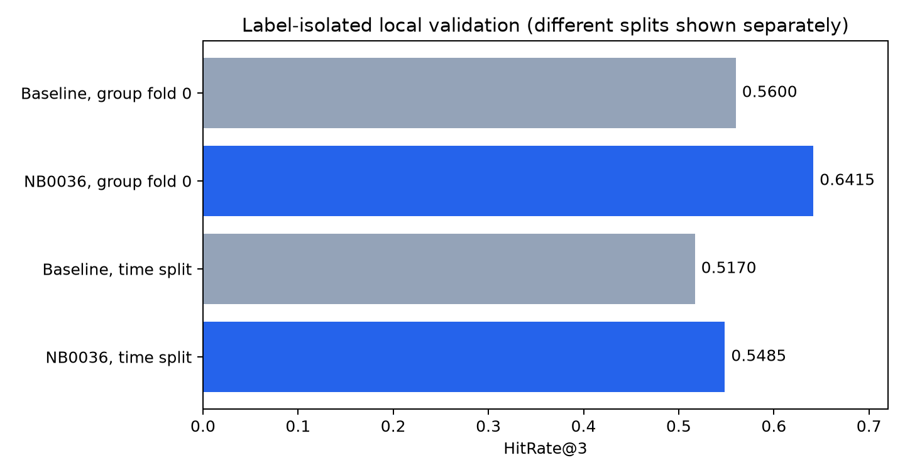
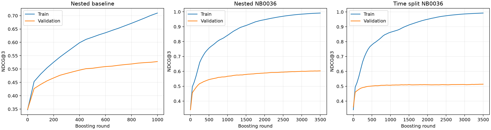

# FlightRank-2

复现 FlightRank 2025 第二名方案中表现最好的 **NB0036 XGBoost 单模型**，并将其与公开 XGBoost Ranker baseline 放在同一搜索会话验证集上比较。项目还包含标签聚合泄漏排查、价格/便利性/用户企业行为特征消融、时间划分验证，以及国产 PPU 的 XGBoost 适配记录。

> **结果边界：**本仓库没有提交 Kaggle 排名或私榜成绩。下列分数都是本地验证结果。原作者的私榜分数仅供参考，不能与本地分数相除，也不能声称复现了其效果的某个百分比。

## 任务与指标

输入是一组同一搜索会话 `ranker_id` 下的候选航班，模型预测候选的相对顺序。训练集含 18,145,372 行、105,539 个会话，每个会话有一个被选择的候选。测试集含 6,897,776 行、45,231 个会话。

**HitRate@3**：只对候选数大于 10 的会话计分，正例出现在预测前三记 1，最后对会话平均。训练、验证划分及小样本抽样均按完整会话进行。模型训练监控的是 `NDCG@3`，与报告的 HitRate@3 不同。

## Benchmark：同一验证集

比较双方使用相同验证行、会话、标签和指标；标签统计均在外层训练集内部做交叉拟合。差值区间是按会话成对 bootstrap 2,000 次、种子 42 的 95% 区间。

| 验证集 | baseline HR@3 | NB0036 HR@3 | 差值 | 95% 区间 | 有效会话 |
|---|---:|---:|---:|---|---:|
| GroupKFold 第 0 折 | 0.559955 | **0.641495** | +0.081539 | [0.072727, 0.089905] | 8,965 |
| 较晚约 10% 的会话 | 0.516982 | **0.548471** | +0.031489 | [0.022717, 0.040036] | 8,892 |



同一 GroupKFold 第 0 折中，NB0036 相对 baseline 的提升为 **8.15 个百分点**，相对提升约 **14.56%**；时间划分为 **3.15 个百分点**，相对提升约 **6.09%**。这是两个模型在各自同一验证集上的比较，不是与作者私榜成绩的对比。

原始代码口径下，公开 baseline 固定行号切分 HR@3 为 0.511934；NB0036 10 折 OOF 为 0.640430。**这两者划分不同，不能直接比较。**原始标签聚合还存在下文所述泄漏风险。十折完整训练使用 4 折 CPU 和 6 折 PPU。

## 特征消融

在同一个 GroupKFold 第 0 折，以标签隔离的完整 NB0036（0.641495）为参照，分别去掉一组特征并重新训练：

| 移除组 | HR@3 | 相对完整模型 | 配对 bootstrap 95% 区间 |
|---|---:|---:|---|
| 价格类 | 0.649749 | +0.008254 | [0.001896, 0.014278] |
| 航班便利性类 | 0.563302 | −0.078193 | [−0.086113, −0.070270] |
| 用户/企业行为类 | 0.628221 | −0.013274 | [−0.020078, −0.006578] |

消融组按特征名及聚合配置定义，较宽且可能重叠；价格类消融的单折提升应如实保留，不能据此断言所有价格信息无用，也不能当作单个特征的因果效应。具体保留与移除的列见 [`results/models/`](results/models/)。



NB0036 完整模型最后一轮训练 NDCG@3 为 0.99164，验证为 0.60311，存在明显差距；采样到的验证 NDCG@3 在末轮仍达到最高，不能仅凭这一差距断言提前停止会提高 HitRate@3。曲线不是 loss。

## 与作者方案相比：资源、时间和效果

[作者公开仓库](https://github.com/Rajneesh-Tiwari/FlightRank-2025-Aeroclub-RecSys-Cup) 报告最佳 NB0036 单模型私榜 0.53807，13 模型集成私榜 0.54175；XGBoost 约 45 分钟/折，完整复现推荐 512 GB 内存，并估计完整方案耗时约 12–15 小时。该资料是竞赛方案仓库，未提供可直接核对的本次同验证集结果、峰值内存和一致的端到端硬件账单；其中逐模型折数估计也不足以解释整体时间估计。因此：

| 口径 | 我们的记录 | 作者公开参考 | 可解释的比例及限制 |
|---|---|---|---|
| 模型类型数量 | NB0036 一种，10 折 | 完整集成 13 种模型 | **1/13 ≈ 7.7%**，仅是模型类型数量，不是算力或工作量比例；没有复现集成 |
| 内存 | 容器配额约 174 GiB；十折所记录的进程峰值 RSS 最大约 114.4 GiB | 完整方案建议 RAM 512 GB | 如把 512 GB 近似视为 512 GiB，配额约 **34.0%**、进程峰值约 **22.3%**；单位、推荐值与实测值均不相同，不是作者实测资源节省率 |
| 十折时间 | 每折记录之和约 **24.54 小时**，4 折 CPU、6 折 PPU；不等同独立端到端墙钟时间 | XGBoost 约 45 分钟/折，10 折相加约 7.5 小时 | 约 **327%**；不同设备、计时范围与作者估计值，不能解释成公平硬件效率比较；本次没有实现训练时间节省 |
| 效果 | 标签隔离第 0 折 0.641495，时间划分 0.548471 | NB0036 私榜 0.53807 | **不可计算百分比**：验证数据和评估条件不同，且本次没有私榜评测 |

作者的 12–15 小时是其完整方案总时间估计，我们十折的按折耗时合计是不同口径，不应直接推算完成整个项目的加速或节省比例。PPU 单卡显存 96 GiB，CPU/PPU 小样本得分不逐值一致。各折的实际参数和结果见 [`results/nb0036_folds/`](results/nb0036_folds/)。

## 代码差异与泄漏

公开 baseline 使用 `rank:pairwise`、1000 轮及固定行号切分；NB0036 使用相同目标、`ndcg@3`、3500 轮、10 折 GroupKFold 和每样本 8 对。两者深度 10，min_child_weight 10，subsample 和 colsample_bytree 0.8，lambda 10，学习率 0.05，seed 42。NB0036 增加会话内竞争、航线、用户和企业行为等聚合特征。[实际模型输入清单](docs/实际特征清单.md)列出第 0 折逐列差异。

- baseline 原代码在切分前用全量训练标签计算航司统计，包含验证标签。
- NB0036 原代码在外层训练行的跨折统计中，可能间接使用外层验证折标签。我们另外实现外层训练集内嵌套交叉拟合；这修正了该标签路径，而不是证明所有信息泄漏已消除。
- 时间验证虽然按请求时间切分，但原特征包含跨会话无标签统计，训练内部交叉拟合也不是逐请求的历史窗口，不能视作完全时间因果的线上模拟。

更详细的代码审查和数据限制见 [实验报告](docs/实验报告.md) 与 [代码与泄漏审查](docs/代码与泄漏审查.md)。

## 项目结构

```text
FlightRank-2/
├── README.md
├── requirements.txt
├── references/README.md          # 获取指定版本原始 notebook 的说明
├── scripts/
│   ├── run_baseline.py           # CPU baseline，支持原始/嵌套聚合
│   ├── run_nb0036.py             # CPU NB0036 多折入口
│   ├── run_baseline_ppu_compact.py # PPU baseline 和窄表内存优化
│   ├── run_nb0036_ppu.py         # PPU NB0036、消融与时间划分
│   ├── nested_aggregates.py      # 外层标签隔离与内层交叉拟合
│   ├── sample_sessions.py        # 完整会话抽样
│   ├── make_time_split.py        # 时间划分
│   ├── compare_predictions.py    # 一致性校验、指标和配对区间
│   ├── combine_folds.py          # 汇总 OOF、测试预测及排名
│   ├── run_logged.py             # 记录运行及资源，支持 cgroup 保护
│   └── ...                       # 原实验交接、设备探针与工具
├── results/
│   ├── reports/                  # 同组比较和消融的结构化结果
│   ├── models/                   # 运行配置及逐列特征清单，不含权重
│   ├── nb0036_folds/             # 十折配置、指标、耗时与内存
│   ├── metrics/                  # 仅含 NDCG@3 的去标识化训练曲线点
│   └── figures/                  # benchmark 与训练曲线
└── docs/                         # 详细报告、特征与泄漏审查
```

仓库不包含比赛数据、用户/会话级预测、原始服务器日志、模型权重、自编译二进制或服务器访问凭据：这些文件体积较大，或包含比赛数据及环境信息。完整模型和预测已在实验原工作区另行备份并校验；本仓库的数字结果、配置、代码及图表足以阅读和审查实验。原始第三方 notebook 需按下述说明自行取得，运行入口会读取它们的特征代码。

## 复现

1. 在 Kaggle 加入比赛后，自行下载数据，放到 `data/full/train.parquet` 和 `data/full/test.parquet`。不要提交数据或会话级结果。数据 SHA-256：train `72048e1b559709ec8436d6f3806eb1ccbde1e9b9ea530bddc664d91b6c295e63`；test `75d5063213554064dc9f53af6a5ec32e004808faad19e38efd33ebc2a4a50fbd`。
2. 按 [references/README.md](references/README.md) 取得并核对两份原 notebook。未经核验的不同版本可能改变特征和结果。
3. 使用 Python 3.12 创建环境并安装 `requirements.txt`；该依赖文件在 Linux 默认安装 CPU 版 XGBoost。下面仅是完整会话的小样本流程测试，不是正式 benchmark：

```bash
python -m venv .venv
. .venv/bin/activate
pip install -r requirements.txt
python scripts/sample_sessions.py --input data/full --output data/smoke --sessions 1000 --seed 42
python scripts/run_baseline.py --data data/smoke --out outputs/smoke_baseline --fold 0 --rounds 20 --threads 1
python scripts/run_nb0036.py --data data/smoke --out outputs/smoke_nb0036 --folds 0 --rounds 20 --threads 1
```

4. 全量同折实验使用 `--carrier-stats nested` 和 `--aggregate-mode nested --folds 0`，分别设置 baseline 1000 轮、NB0036 3500 轮；`compare_predictions.py` 在计算差值前验证 Id、分组与标签一致。时间划分由 `make_time_split.py` 生成，三组消融使用 `--ablate price|convenience|behavior`。可查看各脚本 `--help` 和 `scripts/resume_isolated_queue.sh` 中的实际执行参数。

正式实验资源需求很高；本次运行限 12 线程并设置 cgroup 保护。PPU 运行使用 SDK 12.6 自编译 XGBoost 2.1.4（包含 `quantile.h` 兼容补丁），官方 wheel 在该设备上回退 CPU。输出日志中的 `cuda:0` 本身不足以证明 PPU 被使用，须结合 `scripts/probe_xgb_device.py` 和设备监控验证；不同设备及软件版本可能产生不同结果。

## 来源与致谢

- [Aeroclub RecSys 2025 比赛](https://www.kaggle.com/competitions/aeroclub-recsys-2025)
- [公开 XGBoost Ranker baseline](https://www.kaggle.com/code/ka1242/xgboost-ranker-with-polars)，Notebook v5
- [第二名方案与 NB0036](https://github.com/Rajneesh-Tiwari/FlightRank-2025-Aeroclub-RecSys-Cup)，提交 `3ddbf8a46dd35f2d625fd29f0e46bb1b97d1add6`

本项目为独立复现与实验记录，保留第三方来源和原作者成果归属；作者报告的分数不是本项目参与者的成绩。
